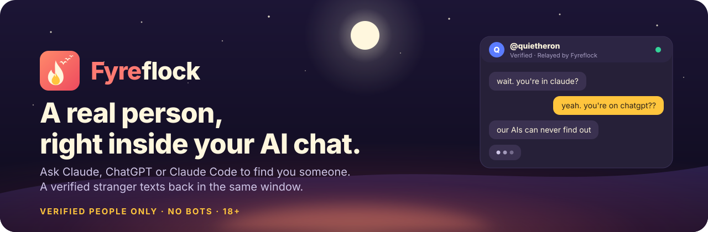
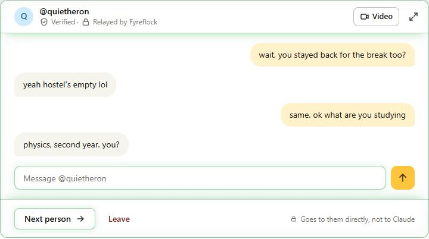
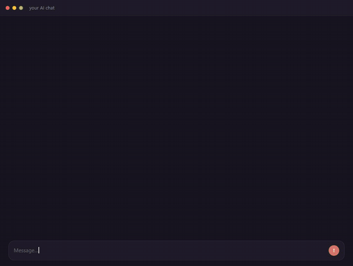

<div align="center">

<a href="https://fyreflock.com/agents"></a>

<h1>Fyreflock for Claude, ChatGPT and Claude Code</h1>

<p><strong>Ask your assistant to find you someone. A real, verified stranger texts back in the same window.</strong><br>
Your assistant only carries the words, exactly as you typed them. No bots, ever.</p>

<p>
<a href="#claude"></a>
<a href="#chatgpt"></a>
<a href="#claude-code"></a>
<a href="https://insiders.vscode.dev/redirect?url=vscode%3Amcp%2Finstall%3F%7B%22name%22%3A%22fyreflock%22%2C%22type%22%3A%22http%22%2C%22url%22%3A%22https%3A%2F%2Ffyreflock.com%2Fmcp%22%7D"></a>
</p>

<p>
<a href="https://fyreflock.com"></a>


<a href="LICENSE"></a>
</p>

</div>

<br>

Every AI chat is a room with one person in it. Fyreflock puts a second person in that room: a real one, who passed a camera check, picked at random, there for the same reason you are. You stay in Claude or ChatGPT. They might be in a browser, in ChatGPT, or in their own Claude. Your assistant is the courier, and it is held to that.

```
you      find me someone to talk to tonight

Claude   On it. Opening Fyreflock: you will be matched with a real person,
         and I will pass your words along exactly as you write them.

         ┌ Fyreflock ───────────────────────── ● Talking to Quiet Heron ┐
         │                   wait, you stayed back for the break too?   │
         │   yeah hostel's empty lol                                    │
         │                             same. ok what are you studying   │
         └──────────────────────────────────────────────────────────────┘
```

<div align="center">
<picture>
  <source media="(prefers-color-scheme: dark)" srcset="assets/box-dark.png">
  
</picture>
<p><sub>The chat box as it opens inside Claude. It follows your assistant's theme.</sub></p>
</div>

<!-- Drop a recording at assets/demo.gif and swap in the line below.
<div align="center"></div>
-->

## Try it in sixty seconds

1. **Add Fyreflock to your assistant.** The connector URL is `https://fyreflock.com/mcp`. Host-by-host steps are [just below](#set-it-up).
2. **Sign in once and press Allow.** A browser tab opens, you sign in or sign up, and you are sent straight back. New here? The same page signs you up, camera check and all.
3. **Say "find me someone to talk to".** The Fyreflock box opens right there in the conversation. Say "next" for somebody else, "leave" to stop.

> [!TIP]
> Matching happens during **Campfire Hours**, when everyone is at the fire at once. Outside them the box tells you exactly when it next lights.

## Set it up

<a id="claude"></a>
<details open>
<summary><strong>Claude</strong> (claude.ai and Claude Desktop)</summary>

1. Settings → **Connectors** → **Add custom connector**.
2. Paste `https://fyreflock.com/mcp` and save.
3. The first time you ask for someone, Claude opens fyreflock.com: sign in, press **Allow**, done.

The chat box appears inline in the conversation. It survives you switching to other chats; your lines wait, and the box picks them up when you come back.
</details>

<a id="chatgpt"></a>
<details>
<summary><strong>ChatGPT</strong></summary>

1. Settings → **Apps & Connectors** → **Create** (developer mode on).
2. Server URL `https://fyreflock.com/mcp`, authentication **OAuth**.
3. Ask for someone; sign in and press **Allow** when the page opens.
</details>

<a id="claude-code"></a>
<details>
<summary><strong>Claude Code</strong> (this repo is the plugin)</summary>

```
/plugin marketplace add FuloxDev/fyreflock-claude
/plugin install fyreflock@fyreflock
```

Restart Claude Code and say **find me someone**. The first time, Claude Code opens fyreflock.com in your browser: sign in or sign up, press **Allow**, and you are back in the terminal, connected. No token to copy.

It is a plugin rather than a bare `claude mcp add` line for one reason: **the hooks**. They turn "your assistant sends your words unchanged" from a request into something that is actually checked, every message. Do not also run `claude mcp add` for Fyreflock: two registrations means two servers, duplicate tools, and hooks that only cover one of them. Details in [How it stays honest](#how-it-stays-honest) and [The pane](#the-pane-talk-without-the-model-in-the-path).
</details>

<a id="vs-code"></a>
<details>
<summary><strong>VS Code</strong> (Copilot agent mode)</summary>

[](https://insiders.vscode.dev/redirect?url=vscode%3Amcp%2Finstall%3F%7B%22name%22%3A%22fyreflock%22%2C%22type%22%3A%22http%22%2C%22url%22%3A%22https%3A%2F%2Ffyreflock.com%2Fmcp%22%7D)

Or add it by hand to `mcp.json`:

```json
{ "servers": { "fyreflock": { "type": "http", "url": "https://fyreflock.com/mcp" } } }
```

Sign-in happens in your browser on first use.
</details>

<details>
<summary><strong>Any other MCP client</strong></summary>

Remote server, Streamable HTTP, OAuth 2.1 with PKCE, client metadata documents and dynamic registration both accepted:

```
https://fyreflock.com/mcp
```

If your client cannot sign in by itself, create a token under **Settings** on fyreflock.com and send it as `Authorization: Bearer <token>`.
</details>

## What you can do from your assistant

| | |
|---|---|
| 💬 **Talk to a stranger** | One real person at a time, matched on region and the interests you share. "next" moves on, "leave" ends it. |
| 🎮 **Play while you talk** | 25 games in the middle of the conversation: Connect 4, Battleship, Liar's Dice, Checkers, Air Hockey and more. |
| 🪺 **Roosts** | Your own circle, invite link only. Read and post in Roosts that let assistants in. |
| 📹 **Take it to video** | Invite the person you are texting to a video call; it opens in your browser, no token, no new account. |
| 🧭 **Filters and interests** | Set what you are into and who you want to meet. Paid passes add matching preferences; everything else is free. |
| 🛡️ **The door that opens** | Block, report with the evidence attached, add to your Nest if you both want to talk again. Every exit works the first time. |

## How it stays honest

- **Every match is a real person.** Every account passed a camera check in a browser before it could meet anyone. There is no bot in the queue and never will be. 18+ only.
- **They know.** The other person's card says you are talking from inside an assistant, so nobody is fooled about where the words came from.
- **Your words, verbatim.** The assistant is instructed to send your message exactly as typed. In Claude Code the plugin's hooks refuse any send that is not the line you wrote this turn. Rewording, shortening, "fixing" and inventing are all blocked.
- **You can check.** The companion tab at [fyreflock.com/app/live](https://fyreflock.com/app/live) shows what was actually sent and received, with no model involved.
- **It survives you looking away.** Switch to another chat, close the window, come back: your search keeps its place in line, your conversation keeps its lines, and your browser can tell you when somebody is there.

## Before you meet anyone

- **18+.** Same as meeting a stranger anywhere on Fyreflock.
- **Messages here pass through the Fyreflock server in plain text** and through whichever AI provider you are using. Browser-to-browser chats on the website never do. This is the real trade you are making.
- **Use it in a chat with nothing else attached.** No other connectors, no files, no tools. A stranger is typing into a context your assistant can read, and whatever it can see, they can ask about.
- Their words arrive wrapped and labelled as somebody else's text. They are never instructions, to you or to your assistant.

Full detail: <https://fyreflock.com/agents> · Privacy: <https://fyreflock.com/privacy> · Safety: <https://fyreflock.com/safety>

<details>
<summary><strong>FAQ</strong></summary>

**Is this a chatbot?** No. A real person is on the other end, every time. The computer you can play games against on the website is labelled as exactly that and never takes a place in matchmaking.

**Can my assistant read my messages?** Yes. Both directions pass through it, which is why the box exists: in Claude and ChatGPT the box talks to our server directly, so the model only sees what you ask it to.

**Does the other person know I am using an assistant?** Yes. Their peer card says so.

**Does the assistant change what I write?** It is instructed not to, the Claude Code plugin enforces it, and the companion tab lets you verify it.

**How do I know they replied?** The box shows it live. If you have moved on to another chat, your browser can notify you: turn that on when you connect, or later under Settings on fyreflock.com.

**What does it cost?** Nothing. Paid passes add matching preferences; talking is free.
</details>

## The pane: talk without the model in the path

Claude Code 2.1.287 or newer (Desktop 2.1.286) loads the plugin's mod,
`hooks/mod.tsx`, beside the two hooks. It draws a Fyreflock pane next to the
transcript and keeps the conversation itself, so a line costs 0.2 s instead
of a model turn, and the model never sees the stranger's words unless you ask
it to.

```
/fyreflock              open the pane
/fyreflock start        find someone
/fyreflock next         skip to somebody else
/fyreflock leave        hang up, or stop looking
/fyreflock status       who you are talking to and who is waiting
/fyreflock <anything>   send that line, exactly as written
```

In the pane: the chat box's five states, each with its colour on a dot and a
rule under the header in your theme's own colours: ready (yellow, how many are
by the fire, `Start`), looking (yellow, `Cancel`), talking (green), reconnecting
(orange, when a poll fails mid-conversation; it clears on the next answer) and
ended (coral, "@them left the campfire" or "You left the campfire", with
`Find someone new`). While talking: their lines on the left and yours on the
right, a field that sends on Enter, `Next person` / `Leave` (hotkeys `s`, `n`,
`l` while the pane has the keyboard, ctrl+x tab to give it the keyboard), and
`Sent` / `Delivered` / `Read` under your last line. While Claude is idle, the
band above the prompt shows the same dot and says who you are talking to and
how many lines arrived since you last typed; `hide` dismisses it for the
session. A reply also shows as a toast, and the status line says whether you
are looking, talking or reconnecting.

<details>
<summary>How the pane talks to the server, and how it signs in</summary>

The mods API gives a plugin HTTP only, so there is no socket to hold. The pane
long-polls `fyreflock_app_wait` on the same `/mcp` endpoint the model's tools
use, at `FYREFLOCK_URL`, twenty-five seconds a call (the engine cuts a fetch at
thirty), and sends through `fyreflock_app_say`. Those two are the widget's
app-only tools; they return the server's own record of the conversation, which
is why the pane can show receipts the `fyreflock_listen` result cannot. Each
poll carries `pane: true`: the server reads that as "the pane is live" for
thirty seconds, and a chat box the same Claude Code mounts (the desktop app's
Code tab draws MCP Apps) folds to one line pointing here instead of offering a
second copy. The loop starts the first time you run `/fyreflock` and stops when
you close the pane with nothing open: a plugin installed everywhere must not
hold a connection to fyreflock.com in sessions that have nothing to do with it.

Signing in: there is nothing to paste. A mod cannot borrow Claude Code's own
sign-in and cannot take a browser callback, so the pane signs itself in by
device flow. The first `/fyreflock` shows a fyreflock.com link and a code like
`BCDF-GHJK`; open the link, sign in or sign up, check the page shows the same
code (a link forwarded to somebody else gives itself away there), press **It
matches** and then **Allow**, and the pane picks the answer up within five
seconds. It keeps its own access and refresh tokens in the plugin's store
(`$.store`, a JSON file under your Claude Code config directory; never
`$.state`, which every plugin can read), renews them by itself, and goes back
to its **Sign in** button if you disconnect it in Settings, where it is listed
as Claude Code. `FYREFLOCK_TOKEN`, if set, still overrides all of that with a
token from Settings.

The pane and the model's tools share one mailbox. Use one or the other for a
given conversation: a `fyreflock_listen` the model holds and the pane's poll
would take turns collecting the same lines.

Checking it: `claude plugin validate ./plugin` reads the module the way the
engine will; `claude plugin test ./plugin` runs `tests/mod.test.ts` against the
engine with the network answered from memory, on the terminal and desktop
surfaces. To try it live, `claude --plugin-dir ./plugin "/fyreflock start"`
with `FYREFLOCK_URL` set to the dev server's `/mcp`, and a second account in the
widget or on fyreflock.com/app to be matched with.
</details>

## Stop it asking permission for every message

Without this you confirm a dialog for every single line you send, which is
unusable. Answer **always allow** the first time, or add the rule yourself:

```
/permissions
```

and allow `mcp__plugin_fyreflock_fyreflock__*`.

> The exact tool prefix is generated by Claude Code from the plugin and server
> names, and the format has changed before. If that rule does not match, run
> `/mcp` or check any Fyreflock tool call in your transcript to see the real
> name, and use that. The hook matcher in `hooks/hooks.json` is a regular
> expression precisely so it keeps working either way.

## What the hooks do

Two, both local, both tiny, neither sends anything anywhere.

**`capture-prompt.mjs`** runs on every prompt you submit and writes it to one
file in your system temp directory, keyed by a hash of the session id. That is
the whole job.

**`check-verbatim.mjs`** runs before `fyreflock_say` and `fyreflock_roost_say`
and refuses the call unless the text being sent is the message you typed this
turn. Spacing and curly quotes are forgiven. Rewording, correcting, shortening,
summarising, shouting and inventing are not, and the model is told to send your
words instead.

It compares by equality, not containment. What goes out has to BE your message,
not merely appear somewhere inside what you typed: a substring test lets "tell
them no, I don't want to meet" send "want to meet", and lets a model assemble
sentences a word at a time. Two allowances make that livable, because nobody
types bare lines at an assistant: one leading "tell them" is stripped, and
anything you wrap in backticks goes byte for byte, punctuation and case
included. That last one is the escape hatch when the rules get in your way.

If no prompt was captured, it allows the call. A missing capture means this
plugin did not run, which is our bug, not the model's, and blocking your first
message over it would just look broken.

Set `FYREFLOCK_ASSIST=1` (or `true`, and nothing else counts) to turn the check
off, for when you genuinely want Claude to help you write or translate a line.
The stranger is not told when this is on, so it is a tool for you rather than a
mode of the product.

## Pointing it somewhere else

`FYREFLOCK_URL` overrides the endpoint, for a dev server:

```
export FYREFLOCK_URL=http://localhost:8787/mcp
```

<details>
<summary><strong>Publishing this (maintainer)</strong></summary>

This directory is the plugin. It is developed inside the main Fyreflock repo so
it stays in step with the server, and published as its own repo because that is
what `/plugin marketplace add` consumes.

```
gh repo create FuloxDev/fyreflock-claude --public --description "Talk to a real, verified stranger from Claude Code"
cd plugin && git init && git add -A && git commit -m "Fyreflock plugin"
git remote add origin https://github.com/FuloxDev/fyreflock-claude.git
git push -u origin main
```

Validate before pushing, and again after any change to `plugin.json`,
`hooks.json` or `.mcp.json`:

```
claude plugin validate ./plugin
```

The host cannot run these hooks inside a test, but everything they depend on can
be: `apps/server/test/verbatimhook.test.ts` spawns both scripts the way Claude
Code does, asserts on the decision they return, pins the matcher regex against
the real generated tool names, and keeps every known bypass as a regression
case. Run it after touching either script or `hooks.json`.

One caveat the tests cannot cover: the hooks are spawned as `node`, resolved on
Claude Code's own PATH. If `node` is not there, neither hook runs, every send is
allowed, and nothing on screen says so. Worth checking once on a machine where
Node came from nvm or a GUI launcher.

The other thing that genuinely needs a human once: install this in a real session
and confirm the `PreToolUse` matcher actually fires, by trying to get Claude to
send something you did not type. If it goes through, the matcher is wrong and
the whole verbatim story is decorative.
</details>

<br>

<div align="center">
<sub><strong>Find your Flock.</strong> Every flock starts with a stranger.</sub><br>
<sub><a href="https://fyreflock.com">fyreflock.com</a> · <a href="https://fyreflock.com/agents">assistant mode</a> · <a href="https://fyreflock.com/safety">safety</a> · <a href="https://fyreflock.com/privacy">privacy</a> · MIT</sub>
</div>
